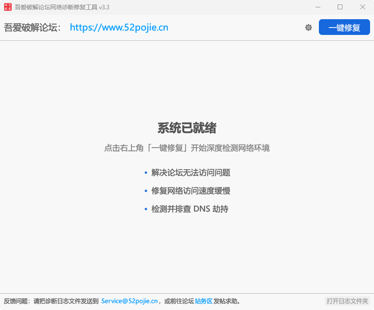

# 吾爱破解论坛网络诊断修复工具

面向吾爱破解论坛（[www.52pojie.cn](https://www.52pojie.cn)）用户的 Windows 网络诊断修复工具，一键检测并修复论坛无法访问、访问速度缓慢、DNS 劫持、验证码异常等常见网络问题。

> **系统要求**：仅支持 Windows 10 及以上版本的系统。

## 功能特性

- **一键修复**：点击「一键修复」自动深度检测网络环境
- **访问异常排查**：解决论坛无法访问的问题
- **速度优化**：修复网络访问速度缓慢的问题
- **DNS 劫持检测**：检测并排查 DNS 劫持
- **访客模式排查**：验证码 / 登录 / 注册 / 发帖异常时，可切换浏览器访客模式排查

## 下载地址

- GitHub Releases：<https://github.com/Hmily-LCG/52pojie-Netdiag/releases>
- 爱盘直链：<https://down.52pojie.cn/Tools/Other/吾爱破解论坛网络诊断修复工具.exe>
- 百度网盘：<https://pan.baidu.com/s/1mgLu7iS>
- 蓝奏云：<https://www.lanzouu.com/b00g4c97af> 密码:52pj
- 阿里云盘：<https://www.alipan.com/s/whPgVVHMKKb>

### 文件校验

| 项目 | 值 |
| --- | --- |
| 文件名 | 吾爱破解论坛网络诊断修复工具_v3.3.exe |
| 文件大小 | 2,672,128 字节（约 2.55 MB） |
| MD5 | `b7d388c4093038db87dd9aa5473c1cb9` |
| SHA256 | `7dba0ba230affe9f087bc83aa97abc73dc49c0e30263b819e5ce98e9d8688e63` |

下载后建议校验文件 hash，确认文件完整且未被篡改。可在命令提示符（CMD）中执行：

```
certutil -hashfile 吾爱破解论坛网络诊断修复工具_v3.3.exe MD5
certutil -hashfile 吾爱破解论坛网络诊断修复工具_v3.3.exe SHA256
```

## 界面预览



## 反馈与支持

欢迎大家收藏备用，使用过程中有任何问题或者建议，请直接将日志通过邮件发送到 service@52pojie.cn 或者跟帖反馈！
